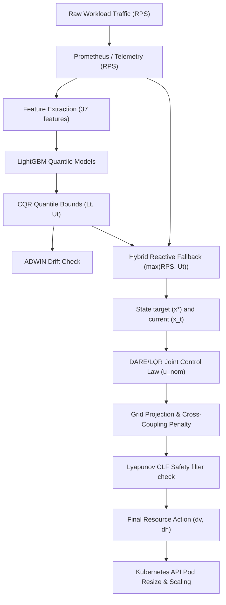

# CHIMERA End-to-End Pipeline Explanation

This document explains the CHIMERA autoscaling pipeline step-by-step from raw workload traffic to the final Kubernetes resource action.

---

## 1. Pipeline Diagram and Data Flow

---

## 2. Detailed Pipeline Stages (Phase 8)

### Stage 1: Application Workload
*   **Input**: Dynamic incoming user requests.
*   **Computation**: Incoming traffic rate varies.
*   **Output**: Incoming request trace.
*   **Why it exists**: The underlying source of demand.
*   **Without it**: No scaling activity.

### Stage 2: Telemetry Gathering
*   **Input**: Request arrivals.
*   **Computation**: Count arrivals in the last 15 seconds (`scale_interval`).
*   **Output**: Current load in requests-per-second (RPS).
*   **Why it exists**: Measures real-time cluster workload.
*   **Without it**: The controller is blind.

### Stage 3: Feature Extraction
*   **Input**: Load history list (in RPS).
*   **Computation**: Extract 37 statistical time/frequency features.
*   **Output**: 37-dimensional feature vector.
*   **Why it exists**: Provides inputs for the ML predictor.
*   **Without it**: Prediction quality degrades to moving averages.

### Stage 4: CQR Predictor
*   **Input**: Feature vector.
*   **Computation**: LightGBM quantile regression + conformal calibration correction ($E_t$).
*   **Output**: Conformal bounds $[L_t, U_t]$.
*   **Why it exists**: Estimates demand uncertainty bounds.
*   **Without it**: The controller cannot provision proactively.

### Stage 5: Hybrid Reactive Fallback
*   **Input**: Measured load and CQR upper bound $U_t$.
*   **Computation**: $\text{target\_demand} = \max(\text{current\_load}, U_t)$.
*   **Output**: Safety-aligned target demand.
*   **Why it exists**: Prevents under-provisioning during out-of-distribution spikes.
*   **Without it**: Catastrophic SLO violations under OOD spikes.

### Stage 6: Joint LQR Controller
*   **Input**: Target state $x^*$ and current state $x_t$.
*   **Computation**: Solve DARE and compute nominal action $u_\text{nom} = -K e_t$.
*   **Output**: Nominal Horizontal/Vertical resizing vector $[dv, dh]^T$.
*   **Why it exists**: Computes optimal tracking trajectory.
*   **Without it**: Resizing is uncoordinated.

### Stage 7: Action Grid Projection & Cross-Coupling Penalty
*   **Input**: Nominal action $u_\text{nom}$ and states.
*   **Computation**: Grid search to minimize LQR distance + cross-coupling cost $\Psi$.
*   **Output**: Coordinated candidate actions.
*   **Why it exists**: Dampens opposing H/V commands and chattering.
*   **Without it**: Replica oscillations and in-place resize chattering.

### Stage 8: Lyapunov CLF Safety Filter
*   **Input**: Candidate actions.
*   **Computation**: Filter out candidates violating CLF stability bounds.
*   **Output**: Final safe control action $u_\text{opt}$.
*   **Why it exists**: Restricts unstable transitions under abrupt drifts.
*   **Without it**: State tracking error overshoot.

### Stage 9: Kubernetes Action
*   **Input**: Safe action $dv, dh$.
*   **Computation**: Patch Deployment replicas horizontally, and patch container CPU limits vertically in-place.
*   **Output**: Resized pods in cluster.
*   **Why it exists**: Enforces physical resource updates.
*   **Without it**: Simulator is disconnected from infrastructure.
